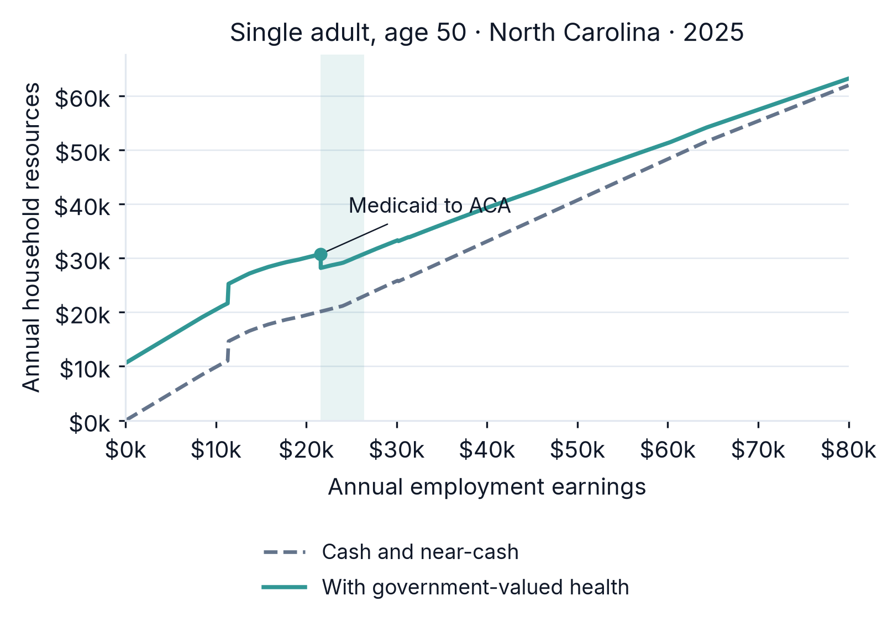
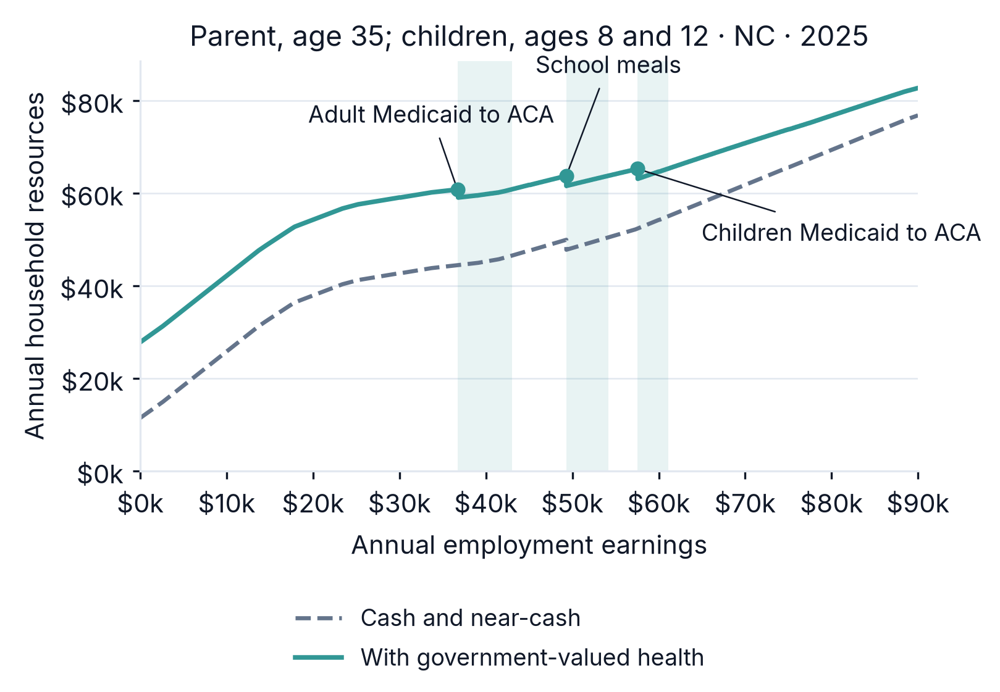
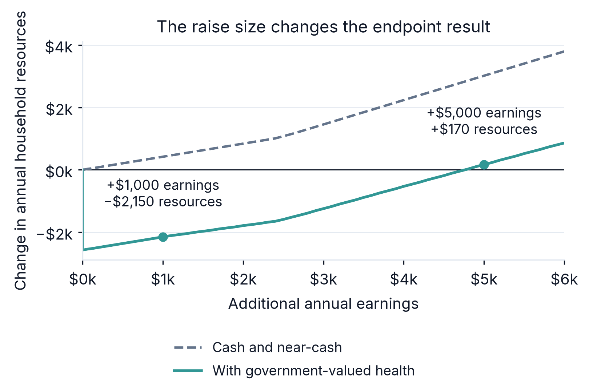
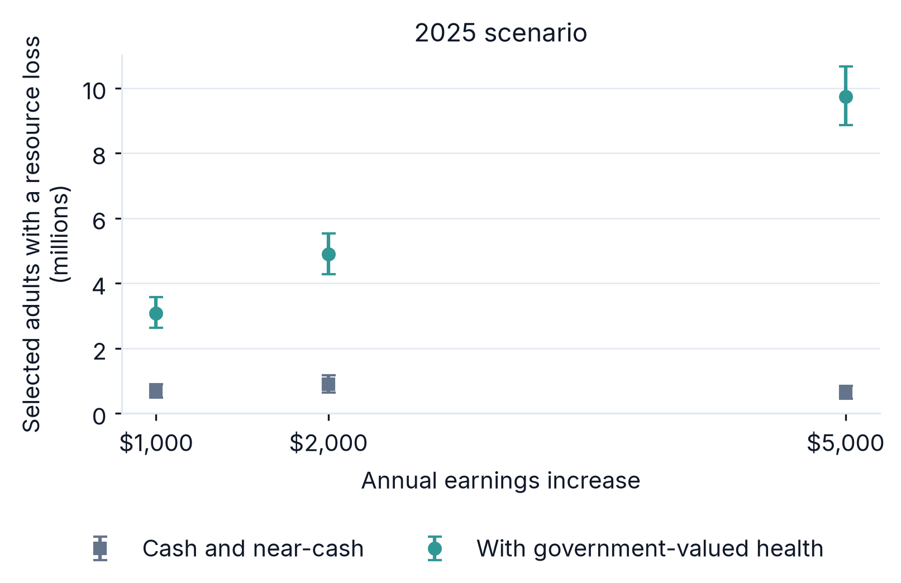
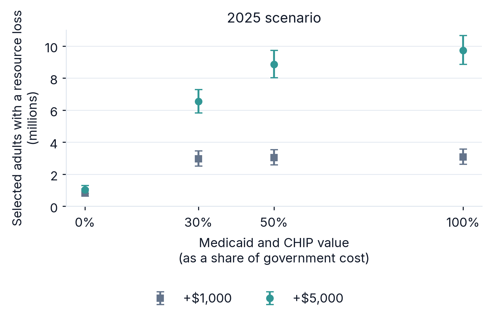
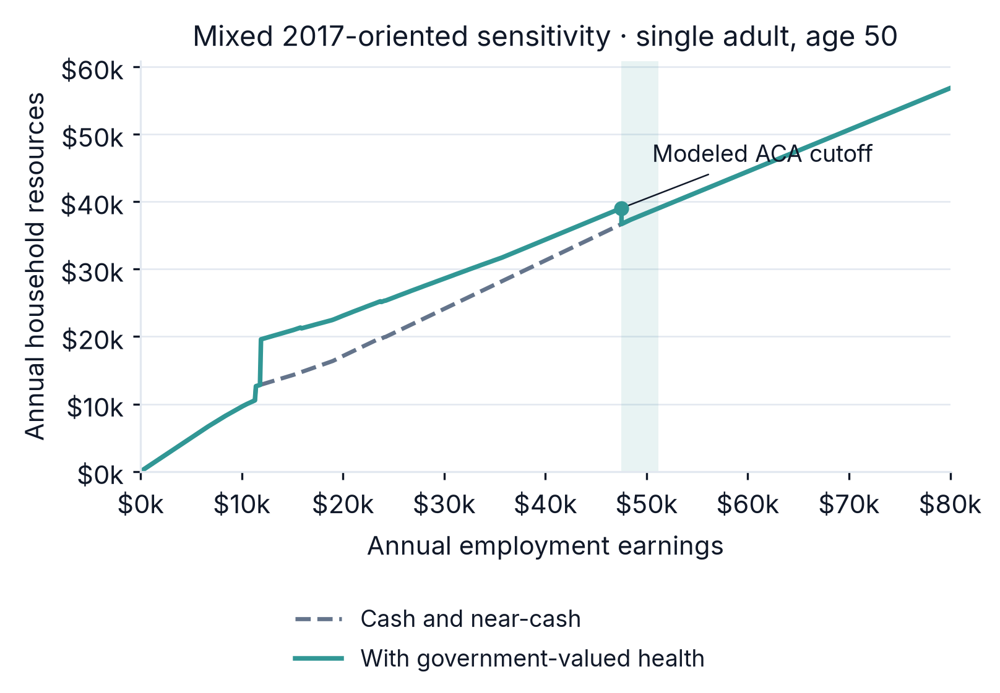

# Cliffs

Max Ghenis · PolicyEngine · 12 November 2026

## Abstract

Cliff estimates for the combined tax-benefit system depend on the earnings transition, resource account and population tested. We examine these choices in a frozen PolicyEngine-US microsimulation evaluated for 2025 using survey-based microdata. We test up to two adults per household, ranked by market income, one at a time. Increasing the annual raise from $1,000 to $5,000 changes the cash and near-cash endpoint-loss count from 0.68 million to 0.63 million selected adults while increasing the count that includes government-valued health coverage from 3.08 million to 9.74 million. The paired increment-by-resource contrast reaches 6.71 million adults (95% sampling interval 6.00-7.44 million). Valuing Medicaid and CHIP at 30% of government cost lowers the $5,000 health-inclusive count to 6.55 million. Across the $1,000, $2,000 and $5,000 grid, strict-loss households of selected workers contain 23.67 million residents. An additional 29.61 million live in households retaining less than half of at least one tested raise, excluding every strict-loss household. Hypothetical household earnings paths illustrate the distinction between a sampled resource drop and a finite-change endpoint loss. We report matched worker rates, paired uncertainty and component attribution. The experiments describe the specified model, not a fully benchmarked estimate of observed incidence or labor-supply responses.

**Keywords:** cliffs, tax-benefit systems, effective marginal tax rates, microsimulation

## 1. Introduction

An earnings increase can reduce a household's resources when additional taxes and lost benefits exceed the additional pay. National estimates of these adverse transitions depend on the raise that an analyst tests, the resources that the analyst counts and the adults whose earnings change. A $1,000 raise and a $5,000 raise can identify different households, and valuing health coverage at government cost can change both the number of losses and its response to the earnings increment.

We use cliffs for adverse finite-change resource comparisons across the tax-benefit system and benefit cliffs when discussing benefit losses specifically. Section 3.3 distinguishes this endpoint measure from a discrete jump in a tax or benefit schedule.

A larger raise acts through two channels. It can move households from farther below a tax or benefit threshold to above it. It also provides more earnings to offset additional taxes or lost benefits. Households that lose resources after a small raise may gain after a larger one, while other households cross a threshold only after the larger raise. The resulting endpoint-loss counts need not increase or decrease together. They also differ from a count of households that encounter any discontinuity anywhere along an earnings path.

Health coverage adds a separate valuation choice. Government expenditure on a household's coverage, the household's willingness to pay and its cost of replacement insurance measure different quantities. Finkelstein, Hendren and Luttmer (2019) develop this distinction using the Oregon Health Insurance Experiment. A household can gain cash and near-cash resources while losing a larger amount of coverage valued at government cost. A count that includes this loss therefore answers a different question from a count based on nonhealth resources.

Earlier microsimulation studies vary the earnings transition, population and resource account. The US Congressional Budget Office (CBO, 2012) uses a $100 earnings increment, while Giannarelli et al. (2019) examine $2,000, $5,000 and $10,000 increases and value Medicaid and CHIP at half government cost. Ghenis and Woodruff (2023) study PolicyEngine cliff measures and earnings-increment sensitivity using simultaneous raises to adults within a household. These conventions motivate a comparison that holds the model and records fixed while stating each transition and resource account explicitly.

We examine three dollar increases, two proportional increases and the corresponding decreases in a frozen PolicyEngine-US model evaluated for 2025. We change one adult's earnings at a time among up to two adults per household, ranked by market income. Dollar raises include selected adults with zero baseline earnings; worker-specific results use the matching selected population with positive net earnings. We also calculate earnings paths for fully specified hypothetical households. These examples illustrate mechanisms and do not estimate their prevalence.

We estimate that a $1,000 raise produces an endpoint loss for 0.68 million selected adults under the cash and near-cash account and 3.08 million when we add health coverage at government cost. Increasing the raise to $5,000 changes the first count to 0.63 million and increases the second to 9.74 million. The health-inclusive difference reaches 6.66 million adults, with a paired 95% sampling interval of 5.93-7.41 million.

We quantify these sensitivities with matched selected-worker denominators, paired sampling intervals, Medicaid and CHIP revaluations, and program-level resource changes. A finite-grid union distinguishes strict losses from retaining less than half of a tested raise, with disjoint household groups. An archival replication illustrates how changing stochastic inputs can create apparent individual losses even when earnings remain unchanged. A separate 2017-oriented experiment remains in the appendices because its later federal and state inputs prevent a historical-incidence interpretation. The main analysis concerns the frozen 2025 model scenario and its stated coverage limits.

## 2. Related measurement approaches

Microsimulation estimates of earnings incentives differ along four dimensions: the earnings transition, the population that receives it, the resource account and the time horizon. Comparisons require all four. An average effective marginal rate does not identify the share of people whose resources fall, and a complete loss of one benefit need not exceed the additional earnings.

Tax research distinguishes discrete changes in liability from changes in marginal rates. Kleven and Waseem (2013) study tax notches in Pakistan, where crossing a threshold changes total tax liability discontinuously. Slemrod (2013) places such jumps within a broader taxonomy of tax-system notches. An upward tax notch can reduce net resources when a small earnings increase triggers a discrete liability increase. At a kink, the budget constraint remains continuous while its slope changes. Saez (2010) studies bunching at such points in the US income-tax schedule, including the Earned Income Tax Credit (EITC), and Kleven (2016) reviews both designs.

Kleven and Waseem (2013) and Saez (2010) use bunching to estimate behavioral responses; we measure simulated annual endpoint losses. Our sign test can flag a notch crossed within an increment or a continuous decline under combined marginal rates above 100%. We do not estimate the prevalence of these mechanisms separately.

CBO (2012) estimates annual effective marginal rates after a $100 earnings increase for selected low- and moderate-income workers. Its 2015 update reports rates for 2016. These distributional summaries describe broader retention patterns than the strict-loss count examined here. The Urban-Brookings Tax Policy Center (2022) uses a $1,000 increment for individual income-tax rates. TAXSIM35 documentation (National Bureau of Economic Research, 2022) specifies a one-cent finite difference and notch-smoothing conventions. Tax-only derivatives and finite-change tax-benefit losses answer different questions; neither convention fixes a universal increment for measuring cliffs.

The US Office of the Assistant Secretary for Planning and Evaluation (ASPE) Marginal Tax Rate Series provides a closer annual tax-benefit comparison. Giannarelli et al. (2019) test $2,000, $5,000 and $10,000 earnings increases, allocate additional work through hours, weeks and wages, and sometimes assign work to nonworkers. They include out-of-pocket childcare expenses and value Medicaid and CHIP at half government cost. Within that framework, Chien and Macartney (2019) distinguish households with a rate of at least 100% from households that lose their entire childcare subsidy. The former includes a plateau at exactly 100%; our strict endpoint-loss test requires a rate above 100%. Their childcare-recipient population also differs from our selected-adult population.

Kosar and Moffitt (2017) examine cumulative rates over earnings bands expressed relative to the poverty guideline, with Medicaid valued at 30% of government cost. Maag et al. (2012) study hypothetical single-parent families across states, earnings transitions and monthly earnings patterns. These studies show how program interactions and the earnings path affect resource retention. Their family cases and participation combinations do not directly supply a nationally weighted endpoint-loss count for the experiment used here.

Time horizons further distinguish the outcomes. Altig et al. (2026 revision) compare current-year and remaining-lifetime net taxation after a $1,000 earnings increase, with $100 and $10,000 sensitivities. Altig, Ilin, Ruder and Terry (2020, revised February 2021) examine short-, medium- and long-term financial outcomes along a hypothetical career pathway. Annual losses can coexist with longer-term gains under those designs. The present experiments compare annual endpoints with household circumstances otherwise fixed; they do not project a career trajectory or a lifetime budget.

Resource valuations require a separate comparison. Finkelstein, Hendren and Luttmer (2019) distinguish recipients' willingness to pay for Medicaid from both gross government expenditure and the net resources required to provide coverage. Their evidence concerns low-income adults affected by the Oregon lottery. It motivates separating expenditure-based accounts from household welfare without supplying a uniform valuation for every person in a national model. We therefore report cash and near-cash resources separately from government-valued health resources and interpret revaluations as accounting sensitivities.

Table A1 summarizes these differences. The comparison concerns defined outcomes within each study, rather than a ranking of estimates from incompatible populations or transitions. Our experiments contribute a common-model comparison across earnings increments and resource accounts, together with paired uncertainty and checks on individual counterfactual consistency.

## 3. Data and methods

### 3.1 Microdata and model scenario

We use the Microcosm 2024 file `populace_us_2024.h5`, fixed at revision `populace-us-2024-spm-20260909`. The file contains 57,240 household records built from pooled CPS Annual Social and Economic Supplement surveys and additional imputations, with calibrated household weights. Some records share an underlying survey-household identifier: the file contains 47,277 distinct source households, including 9,963 that appear in both an ASEC record and a tax-detail record. We preserve that relationship in the bootstrap. The archived [methodology](https://github.com/PolicyEngine/us-cliffs-2017/blob/ff0672e5f7f0728208599d988e9bd3cc2e195391/METHODOLOGY.md) specifies the data inputs and calibration context.

The main experiments evaluate this data in 2025 through the model's forward uprating. We freeze PolicyEngine-US 2.116.0 and policyengine-core 3.34.10. A target-year calculation applies the model's dated parameters and formulas; it does not establish complete coverage of that year's law. Missing program coverage, take-up assumptions and administrative benchmarking remain limitations. The health account allocates 2023 Medicaid spending and uses the model's later CHIP spending and enrollment inputs. We refer to this computation as the 2025 model scenario.

An additional experiment scales later monetary inputs and population weights backward and applies selected 2017 federal provisions, including a custom pre-2018 ACA credit calculation. It retains many later state and federal inputs, family structure and take-up assumptions. We retain its numerical outputs as a mixed-policy sensitivity in the appendices, not as a reconstruction of 2017. Appendix B describes the implications and the parameter-history audit.

The input snapshots, source commits, code hashes and package pins accompany the paper. The replication materials preserve the complete environment, the code for each experiment and aggregate outputs.

### 3.2 Selected adults and earnings perturbations

In each household, the model selects up to two adults with the highest **market income**, which can include income other than earnings. It changes one adult's earnings at a time, holding other household members' inputs fixed and recomputing taxes, benefits and relevant eligibility. This selection can exclude an earner in a household with more than two adults, including when a nonworking adult with other market income ranks above that earner.

For dollar increases, every selected adult receives the specified $1,000, $2,000 or $5,000 change, including those whose baseline earnings equal zero. These experiments reach 222.97 million selected adults in the 2025 model scenario. A dollar reduction requires sufficient positive earnings to cover the reduction. Proportional changes of 1% or 10% require positive earnings components. The engine allocates changes across the positive components of employment income and two self-employment income variables in proportion to their amounts. This construction avoids making a component negative under an admissible cut.

Dollar increments use own-year nominal dollars: 2025 dollars in the main experiments. The appendix's 2017-oriented increments use 2017 nominal dollars. The scenarios combine different policy inputs and population scaling and do not identify a policy-only effect across years.

We separately identify workers using positive net earnings: the signed sum of those three earnings variables. Their population is slightly smaller than the positive-component universe used for proportional perturbations when a self-employment loss offsets another positive component. We retain the definitions rather than asserting exact equality between them.

The selected-worker denominator for dollar raises is 162.91 million. Another 24.90 million earners fall outside the selection. Our conditional worker rates divide selected workers flagged by the test by selected workers reached by that same test. They do not impute the omitted workers' outcomes. A small dollar increase for a nonworker also differs from a full-time job-entry experiment, which is outside this paper's completed design.

### 3.3 Resource definitions and endpoint losses

Let household resources under earnings vector *y* be *R*(*y*). For a selected adult *i*, change only that adult's earnings by Δ and compute:

> **(1)** ΔRᵢ = R(y + Δeᵢ) − R(y).

For a positive earnings increase, the retention fraction is ΔRᵢ/Δ and the finite-change effective marginal rate is:

> **(2)** τᵢ = 1 − ΔRᵢ/Δ.

We flag a strict cliff when ΔRᵢ < 0, equivalently τᵢ > 1. A retention fraction of zero is a plateau and does not satisfy this strict inequality. For a cut, we flag an increase in resources. The common sign rule is:

> **(3)** Δ × ΔRᵢ < 0.

An endpoint loss can reflect a discrete tax or benefit discontinuity, overlapping continuous phase-outs whose combined rate exceeds 100%, or rounding. The flag identifies an adverse finite-change resource comparison; it does not by itself locate a statutory notch. A kink alone changes the marginal rate without creating a discrete resource loss.

This paper applies the rule to the endpoints of each specified change. It does not search every intermediate earnings level. A union across tested increases identifies a loss at at least one tested endpoint. It does not identify every decline along the continuous earnings path. We distinguish the individual-size, positive-grid and raise/cut-union measures.

We use two resource definitions. **Cash and near-cash resources** combine market income, cash and modeled nonhealth benefits, and refundable tax credits, less modeled taxes. The label includes in-kind benefits such as SNAP and school meals; it does not mean literal cash alone. **Health-inclusive resources** additionally count Medicaid, the Children's Health Insurance Program (CHIP), Medicare Savings Programs, the ACA premium tax credit and modeled state health programs at their government-cost values, while retaining CHIP premiums as a cost.

The health-inclusive measure excludes marketplace net premiums. The underlying health toggle adds the premium tax credit and subtracts a marketplace premium already net of that credit. A credit change can therefore enter the original resource difference twice. Our measure removes the signed marketplace-net-premium component entirely, so the premium tax credit enters once. That choice matches the government-cost treatment of the other coverage components. It is not a measure of disposable income after actual replacement-insurance purchases. We do not estimate household willingness to pay, medical risk protection, or uncompensated-care consequences.

For the broader valuation sensitivity, let ΔM and ΔC denote the saved signed changes in Medicaid and CHIP benefits. Holding eligibility, all other health components and premiums fixed, we apply multipliers α in {0, 0.3, 0.5, 1}:

> **(4)** ΔRᵢ,α = ΔRᵢ,full + (α − 1)(ΔMᵢ + ΔCᵢ).

The main sensitivity revalues Medicaid and CHIP together; a supplementary series revalues Medicaid alone. At α = 0 the account still includes the premium tax credit, Medicare Savings Programs and other health benefits. It therefore differs from the cash and near-cash account. The 0.3 and 0.5 choices draw on conventions in the literature but do not reproduce those studies' full resource definitions or populations. We retain each saved native resource difference's rounding residual. Scaling a benefit that increases after the earnings change can also create new endpoint losses, so we recompute flags for every tested adult, including those who had no loss at α = 1.

### 3.4 Comparing increments and constructing unions

A larger earnings increase can cross a new eligibility threshold and provide more earnings to compensate for a benefit loss. These effects can move endpoint-loss counts in opposite directions.

More generally, let *a* denote the distance to a threshold and *L* the benefit lost on reaching that threshold, with other resources increasing dollar for dollar with earnings. For a baseline below the threshold, a positive change Δ produces a strict endpoint loss exactly when:

> **(5)** a ≤ Δ < L.

Increasing Δ can satisfy the crossing condition while eventually failing the loss condition. No nesting relation follows from ordering the increments. A local derivative, a finite endpoint comparison and a search for any decline along an earnings path therefore address different outcomes.

For a finite grid D = {$1,000, $2,000, $5,000}, define a selected worker's flag at retention threshold *c* as:

> **(6)** Uᵢ(c, D) = 1{min[ΔRᵢ(Δ)/Δ : Δ ∈ D] < c}.

We restrict this union to selected adults with positive baseline net earnings. The grid gives every included worker the same set of dollar increases. At *c* = 0, the union counts workers who lose resources after at least one tested raise; at *c* = 0.5, it counts workers who retain less than half of at least one tested raise. The latter includes the former by construction. Equality at the cutoff does not qualify.

For household *h*, Hₕ(c, D) equals one when any selected worker in that household satisfies Uᵢ(c, D). We count residents of qualifying households once, including children and untested adults. The additional-resident group at the half-retention threshold uses Hₕ(0.5, D)[1 − Hₕ(0, D)]. Subtracting adult counts or assigning different earnings grids to the two groups would not construct that disjoint household group. The union remains specific to the tested grid; it supplies no estimate for untested earnings changes or full-time job entry.

### 3.5 Hypothetical household earnings paths

We calculate two hypothetical households in Wake County, North Carolina: a single adult aged 50, and a single parent aged 35 with children aged 8 and 12. Both use the frozen 2025 model scenario. Only the adult's employment earnings vary. We assume annual rent of $14,400, zero childcare spending and assets, and zero other monetary inputs. Household members are citizens without disability or employer-sponsored insurance; adults are not pregnant or students, and children attend school full time. We assume tax filing and take-up of EITC, SNAP, Medicaid, CHIP and the ACA credit, with no TANF or housing-assistance receipt. Rent affects applicable program calculations; we exclude it as a living-expense deduction from plotted resources.

The earnings grid uses $100 steps from zero to $80,000 for the single adult and to $90,000 for the parent. Fresh scalar simulations check the annotated transitions at adjacent dollar amounts and the stated raise endpoints. Each simulation uses the same resource accounting, model versions and fixed national Medicaid valuation totals as the population experiment. These cases use no survey records or population weights. They illustrate the selected mechanisms, rather than representative families or the prevalence of a cliff.

In Figures 1 and 2, the solid line includes government-valued health benefits and the dashed line includes cash and near-cash resources. Shading spans the sampled baseline immediately before a drop through the first $100-grid point recovering that baseline's health-inclusive resources. It marks a baseline-to-recovery range, not a claim that every earnings value in that range yields lower resources. The boundaries depend on the grid; straight lines connect evaluated points as visual guides. The plotted health value is neither spendable income nor willingness to pay, and a Medicaid-to-ACA transition need not imply loss of insurance.

::: {.research-figure}
**Figure 1: Annual earnings and household resources for a single adult.**

*Notes:* Single adult aged 50, with the assumptions stated above. The model changes Medicaid eligibility between $21,600 and $21,601 of annual earnings. The ACA credit offsets part of the government-valued Medicaid loss. The dot uses the $21,600 sampled baseline; shading ends at the first sampled recovery point, $26,400.
:::

::: {.research-figure}
**Figure 2: Annual earnings and household resources for a single parent with two children.**

*Notes:* Parent aged 35 and children aged 8 and 12. Labels identify the modeled adult Medicaid-to-ACA transition, school-meal transition and children's Medicaid-to-ACA transition. Fresh scalar checks place these changes between $36,780 and $36,781, $49,303 and $49,304, and $57,564 and $57,565, respectively. Dots and shading use the $100 sampled baselines and recovery rule described above. These are model boundaries, not independently validated statutory cutoffs.
:::

Figure 3 holds the single adult's baseline at $21,600. An additional $1,000 lowers health-inclusive resources by $2,150, while an additional $5,000 raises them by $170. Cash and near-cash resources rise in both comparisons. The larger raise crosses the same drop and provides enough additional resources to exceed the baseline.

::: {.research-figure}
**Figure 3: Changes in resources from a common earnings baseline.**

*Notes:* The household and resource accounts match Figure 1. Each point subtracts resources at $21,600 of annual earnings. We calculate the marked endpoints at $22,600 and $26,600; labels round resource changes to the nearest dollar. The zero line indicates recovery of baseline resources.
:::

### 3.6 Counts, weights and uncertainty

For each experiment, we count selected adults whose resources move against earnings. We also count households with at least one flagged selected adult and all members of those households. The latter count includes children and untested adults; it does not mean that each member independently faces an earnings cliff. A household counts once even when two tested adults satisfy the criterion.

The archived simulation applies household-calibrated weights and entity mappings. The paper's exhibit builder reads committed scenario aggregates rather than reconstructing survey weights. It computes conditional worker percentages by dividing the matching worker numerator and denominator from the same completed experiment. The build indexes numeric inputs to the generated exhibits by source field, records derived-rate operations and hashes every input snapshot. We do not rescale a count from one earnings experiment to estimate another.

Adult-count intervals use the 2.5th and 97.5th percentiles of 5,000 bootstrap resamples of source households. Records sharing a source household are sampled together. Differences from the $1,000 experiment use paired resamples, preserving the shared records across the compared experiments. We report point estimates for the individual-size conditional worker rates and household-member counts because the archived summary lacks their bootstrap distributions. For the new positive-grid household unions and health revaluations, we construct weighted source-household contributions through MicroSeries and resample those contributions jointly. We derive the interval for additional household members from the paired difference between nested household groups in each draw. We also estimate the contrast [N_health($5,000) − N_health($1,000)] − [N_cash($5,000) − N_cash($1,000)] in each shared draw. Dividing an adult-count interval by a point denominator would not produce a valid interval for a worker rate.

These intervals describe sampling variation under this resampling scheme. They omit uncertainty about policy reconstruction, benefit take-up, health valuation, imputation, calibration and model specification. They also omit CPS strata and sampling clusters and possible repeated households across pooled survey years. The intervals can therefore understate broader uncertainty.

### 3.7 Counterfactual controls and program attribution

Each branch retains the baseline inputs, including stored take-up draws, and recomputes derived outcomes. The tests compare branch outcomes with a fresh simulation of the changed household. A zero-change control should preserve resources exactly. Appendix C examines a historical implementation where this identity failed and separated the failure from the earnings effect.

We split the national dataset into four disjoint source-household groups for computation. Medicaid's valuation uses state enrollment-related totals, so naively recomputing those totals within a quarter-sample would alter every enrollee's value. We fix them at their full-sample baseline values across the parts and branches. Additivity tests compare split with unsplit samples. This is an accounting treatment of an individual earnings counterfactual, rather than an assumption that a single household's raise changes a state's Medicaid budget.

For flagged adults, we identify the single resource component that moves most against the earnings change. Under a raise, this is the largest adverse component; under a cut, the largest gain. This attribution is descriptive. Several programs can change simultaneously, and removing the largest component need not remove the flag when other adverse components remain.

### 3.8 Software assistance

Generative AI assisted software development, literature retrieval, diagnostic review and manuscript preparation. The original analysis used Anthropic Claude Code, with model identifiers `claude-opus-5-5` and `claude-fable-5-2` recorded in its session. The extensions and manuscript used OpenAI Codex, identified by the service as the GPT-6 family; the interface did not expose its exact hosted build. The replication package records the available identifiers and access date in `software-assistance.json`. The executable code, fixed inputs and random seeds determine the estimates without replaying language-model prompts. Tables and Matplotlib figures derive from those outputs; no generative image model produced the figures.

## 4. Results

### 4.1 Dollar increases and health resources

Table 1 reports selected-adult counts for the three dollar increases in the 2025 model scenario. The cash and near-cash point estimate changes from 0.68 million at $1,000 to 0.89 million at $2,000 and 0.63 million at $5,000. Including health produces a different pattern: the count rises from 3.08 million to 4.89 million and 9.74 million. Figure 4 displays these estimates and their sampling intervals.

**Table 1: Selected adults with an endpoint resource loss after an annual earnings increase.** Counts and intervals are millions; frozen 2025 model scenario.

| Scenario | Annual raise | Cash adults (m) | 95% interval | Health adults (m) | 95% interval |
|---|---:|---:|---:|---:|---:|
| 2025 | +$1,000 | 0.68 | 0.49-0.90 | 3.08 | 2.62-3.58 |
| 2025 | +$2,000 | 0.89 | 0.63-1.18 | 4.89 | 4.28-5.53 |
| 2025 | +$5,000 | 0.63 | 0.44-0.84 | 9.74 | 8.87-10.66 |

*Notes:* Cash includes near-cash benefits. Health adds government-valued coverage, counts the ACA premium tax credit once and excludes marketplace net premiums. Intervals cover sampling error only. Dollar raises include nonworkers among the selected adults.

::: {.research-figure}
**Figure 4: Resource definitions change the relationship between the raise and the loss count.**

*Notes:* We evaluate the three marked raise sizes; bars show 95% sampling intervals. The selected population comprises up to two adults per household ranked by market income.
:::

The paired difference between the health-inclusive $5,000 and $1,000 counts reaches 6.66 million adults, with an interval of 5.93-7.41 million. This comparison preserves the shared records across experiments. At $1,000, 77.8% of health-inclusive flags occur for adults whose other resources rise. Most health-inclusive flags therefore concern a gain in nonhealth resources offset by a larger government-valued coverage loss.

### 4.2 Conditional worker rates and household exposure

Table 2 uses matched selected-worker denominators. At $1,000, the health-inclusive rate reaches 1.59% among tested workers, compared with 0.32% for cash and near-cash resources. These rates differ from rates among selected adults because positive dollar raises also reach nonworkers.

**Table 2: Endpoint losses among selected workers reached by each dollar raise.** Frozen 2025 model scenario; denominators include only selected adults with positive net earnings.

| Scenario | Raise | Tested workers (m) | Cash rate (%) | Health rate (%) |
|---|---:|---:|---:|---:|
| 2025 | +$1,000 | 162.91 | 0.32 | 1.59 |
| 2025 | +$2,000 | 162.91 | 0.41 | 2.44 |
| 2025 | +$5,000 | 162.91 | 0.32 | 4.95 |

*Notes:* Rates use matching numerators and denominators within the top-two-market-income adult selection. We do not infer rate intervals from adult-count intervals.

For the $1,000 health-inclusive experiment, 3.08 million flagged adults live in 2.42 million households containing 7.33 million people. The corresponding household-member count reaches 23.05 million at $5,000. A household member need not receive the lost benefit or independently face a cliff. Table A2 reports adults, households and members, including the archival scenario.

### 4.3 Exposure across the positive earnings grid

Table 3 counts residents of households where at least one selected worker satisfies the stated retention test after at least one $1,000, $2,000 or $5,000 increase. We estimate 23.67 million residents in strict-loss households under the health-inclusive account, with a 95% sampling interval of 21.49-26.02 million. The broader below-half-retention group contains 53.28 million residents. Excluding every strict-loss household leaves 29.61 million additional residents, with an interval of 27.28-32.02 million.

**Table 3: Residents of households with selected-worker exposure across the positive raise grid.** Millions, with 95% sampling intervals; frozen 2025 model scenario.

| Scenario | Account | Strict loss | Below half | Additional |
|---|---:|---:|---:|---:|
| 2025 | Cash | 3.73 (2.90-4.65) | 36.20 (33.57-38.92) | 32.47 (30.01-35.04) |
| 2025 | Health | 23.67 (21.49-26.02) | 53.28 (50.02-56.57) | 29.61 (27.28-32.02) |

*Notes:* Both tests use the same $1,000, $2,000 and $5,000 grid and selected workers. Strict loss requires retention below zero. Below half requires retention below 0.5 and includes strict-loss households. Additional excludes every strict-loss household from the broader group. Each resident counts once in a qualifying household. Health counts the premium tax credit once. The grid includes no full-time job entry or continuous search. Intervals cover sampling variation only.

Under cash and near-cash accounting, the strict and additional groups contain 3.73 million and 32.47 million residents. The additional count need not rise with the overall below-half count because it excludes the strict-loss group in each account. Changing the account can alter which households qualify and how they divide between the disjoint groups.

The paired increment-by-resource contrast reaches 6.71 million selected adults, with an interval of 6.00-7.44 million. It compares the change from $1,000 to $5,000 in one resource account's count with the change in the other account's count, preserving their covariance.

### 4.4 Components associated with endpoint losses

Medicaid supplies the largest adverse component for 73% of the $1,000 health-inclusive flags and 89% of the $5,000 flags. Table 4 reports the classification across dollar changes. A larger increase can move a household from farther below a coverage threshold to above it while compensating for a smaller nonhealth benefit loss.

**Table 4: Largest adverse component among health-inclusive endpoint losses.** Shares of flagged adults, percent; frozen 2025 model scenario.

| Scenario | Raise | Medicaid | MSP | CHIP | ACA PTC | Other |
|---|---:|---:|---:|---:|---:|---:|
| 2025 | +$1,000 | 72.6 | 4.4 | 1.6 | 0.0 | 21.4 |
| 2025 | +$2,000 | 75.5 | 6.5 | 1.8 | 0.0 | 16.2 |
| 2025 | +$5,000 | 89.4 | 3.6 | 2.0 | 0.0 | 5.0 |

*Notes:* MSP denotes Medicare Savings Programs; CHIP, the Children's Health Insurance Program; ACA PTC, the Affordable Care Act premium tax credit. Each adult contributes to one component, the one with the largest adverse change. Other components can also contribute. Removing one component need not eliminate the flag; rounding can prevent shares from summing to 100%.

The 2025 scenario does not withdraw the ACA credit solely at 400% of the poverty guideline. Appendix B discusses the cutoff approximation in the separate pre-2018 credit reconstruction.

### 4.5 Direction and small losses

Raise and cut tests reach different populations. A dollar cut requires enough positive earnings to cover it; a raise does not. Table A3 reports the direction-specific counts and union. For a $1,000 raise or cut, the health-inclusive union reaches 4.81 million selected adults. Each adult counts once. This compares exposure on either side of current earnings, rather than after a raise alone.

The strict sign test has no minimum loss threshold. Proportional perturbations can make small losses consequential: in the 2025 1% experiment, approximately 94,200 health-inclusive flags involve annual resource changes of $12 or less. Table A4 records the exact aggregate values and archival comparison. Small changes can interact with monthly rounding. The diagnostic does not classify every small loss as a numerical error or attribute every one to SNAP.

## 5. Valuation and interpretation

### 5.1 Fixed eligibility revaluations

Table 5 applies broader Medicaid and CHIP multipliers to every saved adult counterfactual. At a 30% valuation, we estimate 2.96 million endpoint losses after $1,000 and 6.55 million after $5,000. The corresponding full-cost counts reach 3.08 million and 9.74 million. Figure 5 shows that the $5,000 count responds more to this valuation change than the $1,000 count.

**Table 5: Endpoint losses under alternative Medicaid and CHIP valuations.** Selected adults in millions, with 95% sampling intervals; frozen 2025 model scenario.

| Scenario | Multiplier α | +$1,000 adults | +$5,000 adults |
|---|---:|---:|---:|
| 2025 | 0 | 0.84 (0.63-1.09) | 1.03 (0.78-1.30) |
| 2025 | 0.3 | 2.96 (2.50-3.45) | 6.55 (5.82-7.29) |
| 2025 | 0.5 | 3.04 (2.59-3.53) | 8.86 (8.03-9.74) |
| 2025 | 1 | 3.08 (2.62-3.58) | 9.74 (8.87-10.66) |

*Notes:* The multiplier changes only signed Medicaid and CHIP components. Eligibility, take-up, the premium tax credit, other health components, premiums and native rounding residuals remain fixed. A zero multiplier retains other health benefits and differs from the cash account. We classify every selected adult, including those with gains at full valuation. These accounting sensitivities do not reproduce other studies' complete resource concepts or estimate willingness to pay. The supplementary result file also reports Medicaid-only revaluations.

::: {.research-figure}
**Figure 5: Revaluing Medicaid and CHIP changes the larger-raise count more.**

*Notes:* We evaluate the four marked valuation assumptions (0%, 30%, 50% and 100%); bars show 95% sampling intervals. The premium tax credit and other health components retain their original treatment.
:::

A narrower 80%–120% Medicaid-only sensitivity leaves the $1,000 count at 3.079 million at both endpoints. Stability in that neighborhood coexists with sensitivity to lower Medicaid and CHIP valuations. Neither sensitivity changes program rules or estimates the cost of replacement insurance.

### 5.2 Take-up and program coverage

Take-up assumptions affect the opportunity to lose benefits. The frozen model gives some benefits, including school meals, CHIP and Medicare Savings Programs, to every eligible household or person when the data supply no take-up input. State childcare subsidies generally have no take-up input. A diagnostic removes these benefit groups' changes from already flagged counterfactuals. This removes 18.0% of cash and near-cash flags and 10.7% of health-inclusive flags (Table A5).

The diagnostic counts existing flags that disappear when the specified adverse changes no longer enter resources. It is not an alternative population simulation with calibrated take-up. Lower take-up could also eliminate coverage that the model supplies after another program ends, creating new losses the diagnostic cannot count. A realistic take-up analysis therefore requires coherent baseline and counterfactual receipt, rather than multiplying the cliff count by an assumed participation rate.

Program coverage further limits interpretation. Head Start contributes no benefits in these runs, modeled housing assistance is low relative to the national program's scale, and the full set of modeled program totals has not been benchmarked against administrative spending. Reported SSDI benefits remain fixed when earnings change, so these experiments do not capture an earnings-induced SSDI suspension. Adding a single earnings cutoff would not implement trial-work and extended-eligibility rules. We also omit new work-related childcare expenses. These limitations can move measured exposure in either direction, alongside the full-take-up assumptions above. We do not describe the estimates as lower or upper bounds on all US benefit-cliff exposure.

### 5.3 Interpretation of annual exposure

The experiments measure annual resource changes with other household circumstances held fixed. A simulated loss can identify an incentive in the specified resource account. It does not identify whether a household knows the rule, anticipates the change, receives a temporary continuation of benefits, can adjust spending, or declines an earnings opportunity. Government-valued health losses also do not identify equivalent household welfare losses. Empirical labor-supply responses require a separate design.

## 6. Conclusion

The earnings increment and resource account jointly alter measured exposure to adverse earnings transitions in the frozen 2025 model scenario. Increasing the tested raise from $1,000 to $5,000 raises the health-inclusive endpoint-loss count by 6.66 million selected adults. The paired contrast between the cash and health changes reaches 6.71 million. Lower Medicaid and CHIP valuations reduce the health-inclusive counts, especially at $5,000. Annual government-cost losses cannot identify equivalent losses of spendable income or household welfare.

Hypothetical household paths distinguish a decline along a sampled earnings range from a loss at a specified endpoint. A union across stated raise sizes counts selected workers with a loss at any tested endpoint and residents of their households once. The additional below-half-retention group excludes every strict-loss household. Both groups depend on the same finite grid and selected population.

These comparisons support reporting the earnings transition, resource valuation, selection rule and counting unit alongside each exposure estimate. Shared resampling preserves covariance across accounts and transitions. Input and zero-change controls separate an earnings effect from a change in simulation state. Historical coverage requires a separate rule and data audit; setting a year argument does not supply missing history. The appendix's mixed 2017 scenario consequently remains a computational sensitivity, not evidence of historical incidence.

## Data and code availability

The accompanying replication package contains the analysis source, exact dependency specifications, simulation and aggregation entry points, manuscript build code, input manifests and result aggregates. The source code uses an MIT license. The original experiments and documentation also remain publicly available at [PolicyEngine/us-cliffs-2017, commit ff0672e](https://github.com/PolicyEngine/us-cliffs-2017/tree/ff0672e5f7f0728208599d988e9bd3cc2e195391). The package's metric index maps generated exhibit values to JSON fields. Aggregate-only rebuilding verifies and summarizes archived outputs; full simulation replication additionally regenerates record-level intermediate results in a separate working directory.

Both finished simulation inputs are publicly accessible without registration at the time of access. The main [Microcosm release](https://huggingface.co/datasets/policyengine/populace-us/tree/9a814a3b3b53c0ecd6e1737b6ec862c31300ef6f) resolves to commit `9a814a3b3b53c0ecd6e1737b6ec862c31300ef6f`. Appendix C uses the historical enhanced-CPS file from [revision da98b4f](https://huggingface.co/PolicyEngine/policyengine-us-data/tree/da98b4faccf44492e91d80c0112a34ef6c3da0bd). The public-input manifest records their expected byte counts and SHA-256 identifiers. These inputs support replication of the simulations; the package does not reconstruct Microcosm from every underlying raw survey or administrative source. The package excludes record-level outputs and copyrighted literature PDFs.

## Funding and competing interests

PolicyEngine supported preparation of this manuscript through its general operating resources. A client commissioned related benefit-cliff analysis, including earnings-retention work used here. No specific research grant supported preparation of the manuscript.

Max Ghenis co-founded and leads PolicyEngine, whose software and data this study uses.

## Participants

The study uses secondary survey-based microdata and involves no new participant recruitment or intervention.

## Declaration of generative AI assistance

Anthropic Claude Code and OpenAI Codex assisted coding, analysis checks, source retrieval and writing, as specified in Section 3.8 and the software-assistance record. All estimates and tables derive from the supplied executable code and specified model outputs.

## References {#references}

Altig, D., Auerbach, A., Ilin, E., Kotlikoff, L., & Ye, V. Y. (2026). *The marginal net taxation of Americans' labor supply*. NBER Working Paper 27164, originally issued 2020; revision of 5 February 2026. [Author-hosted revision](https://eml.berkeley.edu/~auerbach/Marginal_Net_Taxation_of_Americans__Labor_Supply___Feb_2026.pdf). [https://doi.org/10.3386/w27164](https://doi.org/10.3386/w27164).

Altig, D., Ilin, E., Ruder, A., & Terry, E. (2020). *Benefits cliffs and the financial incentives for career advancement: A case study of a health care career pathway* (Community and Economic Development Discussion Paper 01-20a, revised February 2021). Federal Reserve Bank of Atlanta. [https://doi.org/10.29338/dp2020-01](https://doi.org/10.29338/dp2020-01).

Chien, N., & Macartney, S. (2019). *Effective marginal tax rates for households with child care subsidies: What happens following an earnings increase?* ASPE Marginal Tax Rate Series, Brief 3. US Department of Health and Human Services. [https://aspe.hhs.gov/sites/default/files/private/aspe-files/260661/brief3-ccdfmtrbrief.pdf](https://aspe.hhs.gov/sites/default/files/private/aspe-files/260661/brief3-ccdfmtrbrief.pdf).

Congressional Budget Office. (2012). *Effective marginal tax rates for low- and moderate-income workers*. [https://www.cbo.gov/publication/43709](https://www.cbo.gov/publication/43709).

Congressional Budget Office. (2015). *Effective marginal tax rates for low- and moderate-income workers in 2016*. [https://www.cbo.gov/publication/50923](https://www.cbo.gov/publication/50923).

Finkelstein, A., Hendren, N., & Luttmer, E. F. P. (2019). The value of Medicaid: Interpreting results from the Oregon Health Insurance Experiment. *Journal of Political Economy, 127*(6), 2836–2874. [https://doi.org/10.1086/702238](https://doi.org/10.1086/702238).

Ghenis, M., & Woodruff, N. (2023, February 2). *How would reforms affect cliffs?* PolicyEngine. [https://www.policyengine.org/us/research/how-would-reforms-affect-cliffs](https://www.policyengine.org/us/research/how-would-reforms-affect-cliffs).

Giannarelli, L., Lippold, K., Maag, E., Steuerle, C. E., Chien, N., & Macartney, S. (2019). *Estimating marginal tax rates using a microsimulation model: Technical appendix*. ASPE Marginal Tax Rate Series, Brief 5. US Department of Health and Human Services. [https://aspe.hhs.gov/sites/default/files/private/aspe-files/260661/brief5-technicalappendix.pdf](https://aspe.hhs.gov/sites/default/files/private/aspe-files/260661/brief5-technicalappendix.pdf).

Internal Revenue Service. (2017, December 12). *Your federal income tax for individuals: For use in preparing 2017 returns* (Publication 17). [https://www.irs.gov/pub/irs-prior/p17--2017.pdf](https://www.irs.gov/pub/irs-prior/p17--2017.pdf).

Kleven, H. J. (2016). Bunching. *Annual Review of Economics, 8*, 435-464. [https://doi.org/10.1146/annurev-economics-080315-015234](https://doi.org/10.1146/annurev-economics-080315-015234).

Kleven, H. J., & Waseem, M. (2013). Using notches to uncover optimization frictions and structural elasticities: Theory and evidence from Pakistan. *The Quarterly Journal of Economics, 128*(2), 669-723. [https://doi.org/10.1093/qje/qjt004](https://doi.org/10.1093/qje/qjt004).

Kosar, G., & Moffitt, R. A. (2017). Trends in cumulative marginal tax rates facing low-income families, 1997-2007. *Tax Policy and the Economy, 31*(1), 43-70. [https://doi.org/10.1086/691083](https://doi.org/10.1086/691083).

Maag, E., Steuerle, C. E., Chakravarti, R., & Quakenbush, C. (2012). How marginal tax rates affect families at various levels of poverty. *National Tax Journal, 65*(4), 759-782. [https://doi.org/10.17310/ntj.2012.4.02](https://doi.org/10.17310/ntj.2012.4.02).

National Bureau of Economic Research. (2022). *Internet TAXSIM version 35: Marginal tax rates*. Accessed 11 November 2026. [https://taxsim.nber.org/taxsim35/](https://taxsim.nber.org/taxsim35/).

Saez, E. (2010). Do taxpayers bunch at kink points? *American Economic Journal: Economic Policy, 2*(3), 180-212. [https://doi.org/10.1257/pol.2.3.180](https://doi.org/10.1257/pol.2.3.180).

Slemrod, J. (2013). Buenas notches: Lines and notches in tax system design. *eJournal of Tax Research, 11*(3), 259-283. [Publisher PDF](https://www.unsw.edu.au/business/sites/default/files/documents/03_eJTR_11_3.pdf).

Stout, N. K., & Goldie, S. J. (2008). Keeping the noise down: Common random numbers for disease simulation modeling. *Health Care Management Science, 11*(4), 399-406. [https://doi.org/10.1007/s10729-008-9067-6](https://doi.org/10.1007/s10729-008-9067-6).

Urban-Brookings Tax Policy Center. (2022). *Brief description of the tax model*, Section IV.C, Effective marginal tax rate estimates. Updated 9 March 2022; accessed 11 November 2026. [https://taxpolicycenter.org/resources/brief-description-tax-model](https://taxpolicycenter.org/resources/brief-description-tax-model).

## Appendix A Comparability and full results

### A.1 Earnings conventions in the literature

**Table A1: Earnings conventions and resource concepts in selected primary sources.** Entries concern each source's stated experiment, not a common national cliff rate.

| Source | Earnings convention | Population or unit | Principal distinction |
|---|---|---|---|
| Ghenis & Woodruff (2023) | +$2,000 per adult; increment sensitivity | Households; simultaneous adult increases | Household pooling differs from one-adult counterfactuals |
| CBO (2012) | +$100 | Selected low- and moderate-income workers | Annual taxes and selected transfers |
| ASPE (2019) | +$2,000, +$5,000, +$10,000 | Selected working-age households | Medicaid/CHIP at half government cost; childcare expenses |
| Altig et al. (2026 revision) | +$1,000; +$100/+$10,000 sensitivities | Selected SCF households | Current-year and lifetime concepts |
| Kosar and Moffitt (2017) | 50%-FPL bands | Family types and participation combinations | Medicaid at 30% of government cost |
| Maag et al. (2012) | Poverty-line transitions | Hypothetical single-parent families | Monthly earnings timing and state variation |
| TAXSIM35 | +$0.01 | User-provided tax records | Local tax rate with notch smoothing |
| TPC (2022) | +$1,000 | Tax units | Individual income-tax rate |

*Notes:* Full source locators and retrieval records accompany the paper. No source's mean, median, conditional cell or recipient-only percentage is treated as a nationally comparable strict-cliff rate.

### A.2 Additional empirical results

The 2017 rows below describe the archival mixed-policy sensitivity defined in Appendix B. They are not estimates of historical incidence.

**Table A2: Adults, household unions and household members under dollar raises.** All counts are millions. Sampling intervals for the 2025 adult counts appear in Table 1.

| Scenario | Raise | Measure | Adults (m) | Households (m) | Members (m) |
|---|---:|---:|---:|---:|---:|
| 2017 | +$1,000 | Cash | 0.69 | 0.46 | 1.74 |
| 2017 | +$1,000 | Health | 2.68 | 1.98 | 6.20 |
| 2017 | +$2,000 | Cash | 0.67 | 0.43 | 1.84 |
| 2017 | +$2,000 | Health | 4.39 | 3.22 | 10.22 |
| 2017 | +$5,000 | Cash | 0.30 | 0.23 | 0.77 |
| 2017 | +$5,000 | Health | 9.42 | 7.15 | 21.67 |
| 2025 | +$1,000 | Cash | 0.68 | 0.45 | 1.85 |
| 2025 | +$1,000 | Health | 3.08 | 2.42 | 7.33 |
| 2025 | +$2,000 | Cash | 0.89 | 0.55 | 2.18 |
| 2025 | +$2,000 | Health | 4.89 | 3.76 | 11.67 |
| 2025 | +$5,000 | Cash | 0.63 | 0.42 | 1.74 |
| 2025 | +$5,000 | Health | 9.74 | 7.51 | 23.05 |

**Table A3: Raise, cut and either-side counts under the health-inclusive resource measure.** All counts are millions.

| Scenario | Size | Raise (m) | Cut (m) | Either side (m) | 95% union interval |
|---|---:|---:|---:|---:|---:|
| 2017 | $1,000 | 2.68 | 2.22 | 4.84 | 4.27-5.40 |
| 2017 | $2,000 | 4.39 | 3.66 | 7.90 | 7.12-8.67 |
| 2017 | $5,000 | 9.42 | 7.21 | 16.25 | 15.16-17.37 |
| 2017 | 1% | 0.83 | 0.97 | 1.74 | 1.46-2.06 |
| 2017 | 10% | 3.38 | 3.88 | 7.06 | 6.41-7.72 |
| 2025 | $1,000 | 3.08 | 1.84 | 4.81 | 4.21-5.43 |
| 2025 | $2,000 | 4.89 | 2.98 | 7.62 | 6.89-8.38 |
| 2025 | $5,000 | 9.74 | 5.51 | 14.72 | 13.63-15.81 |
| 2025 | 1% | 0.96 | 0.97 | 1.83 | 1.53-2.16 |
| 2025 | 10% | 4.82 | 3.66 | 8.07 | 7.37-8.81 |

*Notes:* A cut must be covered by positive earnings components; a proportional change requires a positive component. Dollar raises also include selected nonworkers. The union contains adults flagged in either direction once. It is not the sum of the two columns and does not search the interval continuously.

**Table A4: Small-loss diagnostic for positive earnings changes.**

| Scenario | Raise | Measure | Flagged (m) | Loss <=$12 (000s) | Share of flags (%) |
|---|---:|---:|---:|---:|---:|
| 2017 | +$1,000 | Cash | 0.69 | 6.7 | 1.0 |
| 2017 | +$1,000 | Health | 2.68 | 14.8 | 0.6 |
| 2017 | +$2,000 | Cash | 0.67 | 13.4 | 2.0 |
| 2017 | +$2,000 | Health | 4.39 | 13.4 | 0.3 |
| 2017 | +$5,000 | Cash | 0.30 | 6.6 | 2.2 |
| 2017 | +$5,000 | Health | 9.42 | 28.4 | 0.3 |
| 2017 | +1% | Cash | 0.50 | 133.7 | 26.6 |
| 2017 | +1% | Health | 0.83 | 126.5 | 15.3 |
| 2017 | +10% | Cash | 0.43 | 40.4 | 9.3 |
| 2017 | +10% | Health | 3.38 | 40.4 | 1.2 |
| 2025 | +$1,000 | Cash | 0.68 | 0.0 | 0.0 |
| 2025 | +$1,000 | Health | 3.08 | 0.0 | 0.0 |
| 2025 | +$2,000 | Cash | 0.89 | 0.0 | 0.0 |
| 2025 | +$2,000 | Health | 4.89 | 0.0 | 0.0 |
| 2025 | +$5,000 | Cash | 0.63 | 5.2 | 0.8 |
| 2025 | +$5,000 | Health | 9.74 | 17.0 | 0.2 |
| 2025 | +1% | Cash | 0.58 | 104.8 | 18.2 |
| 2025 | +1% | Health | 0.96 | 94.2 | 9.8 |
| 2025 | +10% | Cash | 0.58 | 7.7 | 1.3 |
| 2025 | +10% | Health | 4.82 | 7.7 | 0.2 |

*Notes:* The last column divides the archived count with losses of no more than $12 by the archived strict-loss count in the same experiment. It does not estimate a separate unrun policy scenario.

**Table A5: Dependence of existing $1,000 flags on specified full-take-up benefit changes.**

| Scenario | Resource measure | Existing flags removed (%) |
|---|---:|---:|
| 2017 | Cash | 50.7 |
| 2017 | Health | 20.0 |
| 2025 | Cash | 18.0 |
| 2025 | Health | 10.7 |

*Notes:* The diagnostic removes changes in selected benefit groups from already flagged rows. The state-benefit group also contains some benefits whose receipt follows SSI or TANF. New flags resulting from lower take-up of substitute health coverage are outside this diagnostic.

## Appendix B Historical-policy and computational boundaries

The archival 2017-oriented scenario applies selected 2017 federal tax provisions and an explicit reconstruction of the ACA premium tax credit, but retains later information in several domains. The frozen model initializer copies each parameter leaf's earliest available value backward to 2015 when earlier history is absent. Setting a simulation year to 2017 therefore does not reconstruct missing 2017 law.

An audit of parameters read by that scenario identifies 1,571 raw-file state-tax parameter nodes, of which 1,080 contain a leaf whose first value is after January 1, 2017; 841 of those nodes first appear in 2021. The corresponding later-start counts are 491 of 536 traced state-childcare nodes and 208 of 752 federal nodes. These parameter histories count nodes, rather than laws, affected households or incorrect outputs. A later first date does not establish when a rule was enacted, and tracing a parameter does not establish that it changes benefits. The model's earliest state Medicaid and CHIP limits and WIC package values begin in 2018, while some formulas refer explicitly to still later dates. Together with later household information and health valuations, these substitutions prevent a historical-incidence interpretation.

The frozen ACA implementation also approximates the exact income boundary. It truncates income to whole percentage points of the poverty guideline and denies the credit at a truncated 400%, including exactly 400%, where the inclusive limit allows it ([IRS Publication 17, 2017, Chapter 37](https://www.irs.gov/pub/irs-prior/p17--2017.pdf)). Its treatment of incomes just above the statutory limit can also depend on tax-form rounding conventions that this analysis has not established. The reported 400% crossings therefore describe the model's rule, rather than exact statutory classification at every boundary. The historical parameter audit also records small poverty-guideline differences. These limitations matter particularly for a subgroup carried by few source households.

Figure B1 retains an illustrative ACA-credit drop from this mixed-policy scenario. It uses the single-adult specification from Section 3.5 with the scenario year set to 2017 and the custom pre-2018 ACA calculation. Its earnings grid and scalar checks follow the same procedure. It does not depict a fully reconstructed 2017 household budget or establish the historical cutoff.

::: {.research-figure}
**Figure B1: An ACA-credit drop in the mixed 2017-oriented sensitivity.**

*Notes:* Hypothetical single adult aged 50 in Wake County, North Carolina. The plotted model changes ACA-credit status between $47,519 and $47,520. Relative to the sampled $47,500 baseline, a $1,000 raise lowers health-inclusive resources by $1,657 and a $5,000 raise raises them by $814. The shaded range ends at the first sampled recovery point, $51,200. Later policy inputs and the boundary approximation described above preclude a historical-law interpretation.
:::

The 2025 scenario uses the same underlying source records and the model's forward uprating. It also requires a coverage qualification. A bounded trace using two households in each state and the District of Columbia reads 3,760 raw-file parameter nodes; 139 contain a leaf first dated after December 31, 2025. The trace reads some future-start parameters through programs gated off for 2025, while inspected Georgia childcare eligibility formulas use backfilled 2026-source parameters without a calendar start gate. This trace does not establish positive benefits, historically incorrect values or the size of any national effect. Its sample and scenario differ from the 2017 audit, so the counts do not measure a change in coverage. We describe the main experiment as a frozen 2025 model scenario, rather than fully validated 2025 law. The replication package supplies the audit metadata and source identities.

We exclude the Commodity Supplemental Food Program from the 2025 household-benefit account to align the benefit list with the archival scenario. This exclusion changes the cash and near-cash count relative to the frozen model's default benefit list. It is part of the experiment's definition rather than a general claim about the program's importance.

The bootstrap draws source-household identifiers, jointly including the paired ASEC and tax-detail copies. It therefore respects a known duplication in the microdata but does not recreate the original survey design or recalibrate each draw. Fixed state Medicaid totals also remain fixed in the resamples. The displayed intervals omit model and calibration uncertainty.

Replication requires the specified package versions, data revision and resource definitions. Updating the software or data changes the experiment and requires renewed baseline, counterfactual and program-coverage checks.

## Appendix C Preserving stochastic inputs in counterfactual comparisons

An earlier PolicyEngine-US implementation provides a controlled example of a counterfactual failure. The April 2025 model used random draws for SSI's asset test, WIC take-up and WIC nutritional risk. Its copied household drew again while recomputing resources. Some adults therefore lost benefits for reasons unrelated to the earnings perturbation. Those changes could be counted as cliffs when they exceeded the raise's own resource gain.

A reconstruction of PolicyEngine-US 1.251.1 with policyengine-core 3.16.6 and the historical enhanced-CPS file produces 7.36 million flagged adults. Holding the draws fixed in the same model and data produces 0.82 million, with a 95% sampling interval of 0.32-1.51 million. The ratio of those point estimates is 8.94. A zero-earnings-change control produces approximately 10.53 million flags with the redraw behavior and none when the draws are held fixed. The [replication archive](https://github.com/PolicyEngine/us-cliffs-2017/blob/ff0672e5f7f0728208599d988e9bd3cc2e195391/CORRECTION.md) records the historical versions, diagnostic experiments and uncertainty.

This comparison isolates the draw-handling change within that older model. It does not attribute every difference between the old and newer estimates to that change: the later experiments also change microdata, model version, take-up mapping and program coverage. In the draws-held historical replication, only 149 source households carry the flagged count, and two supply half. The sampling concentration limits its precision.

Common random numbers are an established simulation technique. [Stout and Goldie (2008)](https://pmc.ncbi.nlm.nih.gov/articles/PMC2761656/) describe synchronized draws for individual counterfactual comparisons. The implication here concerns a diagnostic rather than a new variance-reduction method: zero-change comparisons should preserve every household's outcomes, and an earnings branch should match a fresh simulation with identical retained inputs. A seed alone does not ensure that condition if draw order or branch state changes.
